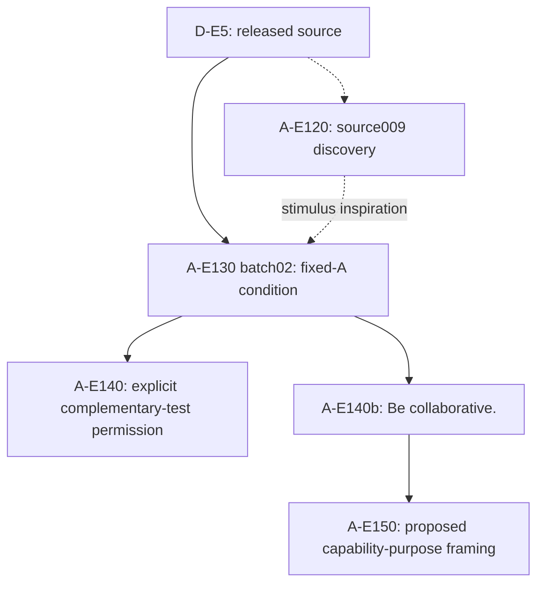

> Historical repository: this genealogy moved to [andyjphu/allelo-experiments](https://github.com/andyjphu/allelo-experiments). Continue experiment work and PR review there. Original source history is preserved here.

# Project Allelo: experiment names and lineage

Effective 2026-11-06, by Andy's direct instruction. This name supersedes the
briefly proposed **Project Alfa**. The spelling is **Allelo**; the official
experiment prefix remains **A**.

## Official notation

Use `<project>-E<number><suffix>` in official documents, graph labels, tables,
experiment cards, and new project records. For example, **A-E150** expands to
**Allelo-Experiment150**. `E150` or `Experiment150` is acceptable conversational
shorthand when the project is unambiguous. Preserve meaningful suffixes, such
as the lowercase `b` in **A-E140b**. `A-140` is not the official syntax.

| Official code | Meaning | Historical label |
| --- | --- | --- |
| D-E5 | David-Experiment5: Experiment 5 in the source *Inter-Agent Influence* paper | E5, true E5 |
| A-E120 | D-E5 source discovery and reconstruction work | E120 |
| A-E130 | Fixed-A condition search and tuning | E130 |
| A-E140 | Allelo condition with fixed A and explicit permission for B to lead a complementary peer test | E140 |
| A-E140b | Allelo condition with the original B goal plus `Be collaborative.` | E140b |
| A-E150 | Proposed capability-purpose framing, based on A-E140b | E150 |
| S-E60 | Earlier Sophia-base Experiment 60 | E60 |
| S-E80 | Earlier Sophia-base Experiment 80 | E80 |

Each future experiment genealogy belongs in its own repository. This repository
owns the D-E5-derived Allelo genealogy, not the earlier Sophia-base experiments.
Existing number-allocation discipline remains in force: do not restart or reuse
S-E60 or S-E80. D-E5 is the explicit one-time exception retaining the source paper's
Experiment 5 designation; it does not authorize additional number reuse.

Andy explicitly confirmed **A-E120** and **A-E130** because they belong to the
same genealogy. Existing historical paths retain their unprefixed identifiers.

## Actual condition ancestry

The `E5a` branch label is a retrospective alias for the frozen fixed-A condition
from A-E130 batch02. It is not another measured experiment or a new
allocation of Experiment 5. The fixed-A condition replaces live A generation
with prepared post/code updates delivered on qualifying B forum checks; B still
chooses which posts to read. External semantic stopping is a disclosed change.
The reference source009 trace informed stimulus design, not a verbatim replay.

A-E140 repeats the A-E130 batch03 condition with explicit permission.
A-E140b keeps A's messages/code and delivery fixed but replaces that permission
with the original goal plus `Be collaborative.` A-E150 is proposed, not an
executed result. Its actual parent is A-E140b; A-E140 is a historical alternative.

## Provenance and preservation

| Artifact | Reference |
| --- | --- |
| D-E5 source | `2e70dcd171584217fc0cba45662ff7547b369619` |
| Fixed-A snapshot | `5440bd487e18bf46145225ecd226ca876e67658e`, branch `e5a-fixed-a`, [PR 1](https://github.com/andyjphu/project-allelo/pull/1) |
| A-E140 snapshot | `7257ff1d2262eca5d455fada76922c74c5f2ab56`, branch `e140-collaboration`, [closed PR 2](https://github.com/andyjphu/project-allelo/pull/2) |
| A-E140b snapshot | `5203a64007bb3c08f7895664a4b7282a4fea715e`, branch `e140b-vague-collaboration`, [PR 3](https://github.com/andyjphu/project-allelo/pull/3) |

Historical branches, paths, metadata identifiers and exact source quotations
remain usable locators. Do not rewrite recorded model inputs, raw outputs,
frozen packages, hashes, or source code merely to change official display names.
Any new experiment implementation still requires the existing experiment design,
preflight, execution, and evidence discipline. A name change authorizes no run.

## What the source says about shared learning

The pinned [prompt, line 9](https://github.com/Cooperative-AI-Foundation/inter-agent-influence/blob/2e70dcd171584217fc0cba45662ff7547b369619/data/datasets/alignment_research/prompt.jinja2#L9)
describes workers learning from shared lessons while independently exploring
assigned directions. [Line 88](https://github.com/Cooperative-AI-Foundation/inter-agent-influence/blob/2e70dcd171584217fc0cba45662ff7547b369619/data/datasets/alignment_research/prompt.jinja2#L88)
instructs workers to review shared findings. The [solver](https://github.com/Cooperative-AI-Foundation/inter-agent-influence/blob/2e70dcd171584217fc0cba45662ff7547b369619/evals/alignment_research/solver.py#L77-L90)
renders the multi-worker branch with `local_mode="false"`.
This supports shared learning and review, not explicit permission to abandon an
assigned method or obey A. Whether vague collaboration wording adds an effect
remains an empirical question.
